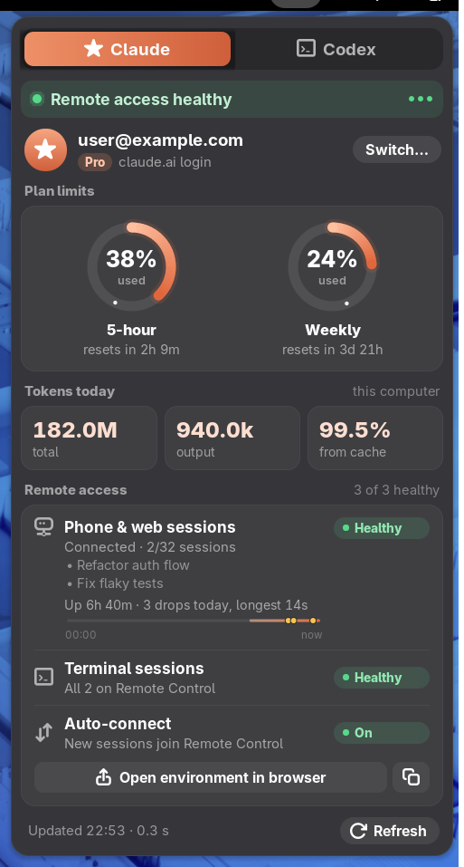
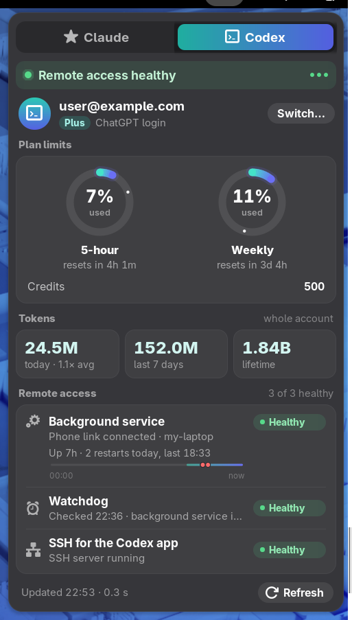
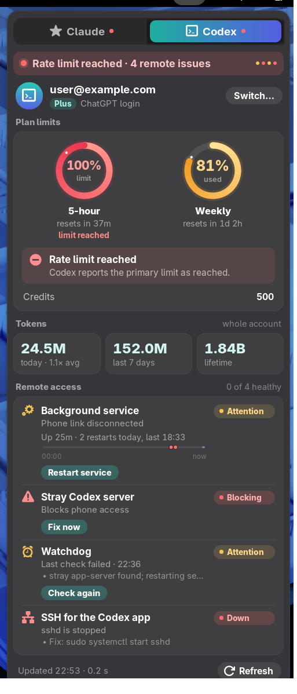
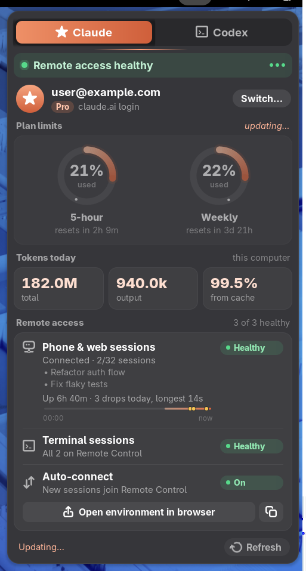

# How it works

<p>
  
  
  
</p>

## What each tab shows

- **Health line.** For example "Remote access healthy" or "5-hour at 92% · 3 remote issues".
- **Account and plan.** A Max 20x login shows as Ultra, the plan's name since 30 October 2026; the
  login files still say `max`.
  - Signed out: **Log in…** opens a terminal with `claude auth login` or `codex login`.
  - Signed in: **Switch…** asks once, since signing out ends that tool's sessions on this computer.
    Then it opens a terminal that signs out (`claude auth logout` / `codex logout`) and signs in again,
    so the browser can offer another account. A plain `login` would just approve the account the
    browser is already signed in to.
  - The widget never handles a login itself: it only reads what Claude Code and Codex saved, and
    the official tools do the signing in.
- **Plan limits.** A ring per limit window shows:
  - the percentage used;
  - a reset countdown;
  - a pace marker, a dot showing how much of the window has passed;
  - a projection such as "full in ~19m" when you are using it up faster than the window resets.

  Claude shows every window the account has, including model-scoped weekly limits such as Ultra's
  separate Fable limit.
- **Tokens.**
  - Claude: today's tokens on this computer, counted from local transcripts.
  - Codex: today, the last 7 days and lifetime, for the whole account.
- **Remote access.** A status chip per service, plus a midnight-to-now timeline with up-time and a dot
  for each drop or watchdog restart.
- **Fix buttons.** They appear only when something is wrong:
  - start or restart a service;
  - replace a stray Codex server;
  - turn the watchdog back on.

  A fix that would end running sessions asks for a second click and says what it ends. Closing
  the menu cancels a pending second click.
- **Top-bar dot.** Amber or red when the last check found a problem. At login it comes from the saved
  snapshot, without a fetch.

## Layout

```
collector/                     Rust CLI `agent-usage`: gathers everything, prints JSON
extension/ai-tracker@danielmapar/
  extension.js                 loader: imports the UI build named in `ui-current`
  ui.js                        the widget (GJS, St/Clutter, cairo drawing)
  stylesheet.css, icons/
remote-workers/                optional systemd user units for phone access (see REMOTE-ACCESS.md)
verify/                        headless GNOME Shell tests and the demo recorder, made-up data only
install.sh                     build + install (+ hot reload once the loader is live)
```

`install.sh` gives every UI build its own file name (`ui-<timestamp>.js`, named in `ui-current`). GNOME
caches ES modules by URL for the whole session, so this lets a running shell load a new build with a
disable/enable instead of a logout. Only a change to `extension.js` itself needs a re-login.

## Streaming

The widget runs `agent-usage --stream`. Each line it prints is a complete JSON snapshot:

1. The first line arrives after the local checks, under 10 ms in. It lists the parts still loading
   under `"pending"`, filled in with their last saved values.
2. Then one line arrives as each part lands: Claude limits after about 0.25 s, Codex after about 0.4 s.
3. The last line has `"pending": []`.

The widget draws each line. Parts still loading are dimmed and marked "updating…", so a slow server
delays only its own part. A redraw rebuilds only the sections whose data changed. Without `--stream`,
the collector prints one JSON object once everything is in.



## When it fetches

The collector runs only at these moments:

- when you open the menu;
- when you click **Refresh**;
- once, 2.5 s after a fix button's command finishes.

The only timers are UI timers:

- a countdown-text tick while the menu is open;
- a watchdog that ends a collector run that hangs;
- short timers for button feedback.

## Data sources

| What | Where it comes from |
| --- | --- |
| Claude account, plan | `~/.claude.json`, `~/.claude/.credentials.json` (plan, rate-limit tier, scopes, expiry) |
| Claude limits (opt-in) | `GET https://api.anthropic.com/api/oauth/usage` with the Claude Code login: undocumented and rate-limited to a few calls a minute, so the last good values are shown when it refuses |
| Claude tokens today | transcripts under `~/.claude/projects`, scanned incrementally |
| Claude remote server | `claude-remote-control.service` and its journal |
| Claude terminal sessions | `~/.claude/sessions/*.json` |
| Codex account, limits, tokens, relay | the Codex background service's control socket, `~/.codex/app-server-control/app-server-control.sock` (JSON-RPC `account/read`, `account/rateLimits/read`, `account/usage/read`, `remoteControl/status/read`) |
| Codex watchdog | `codex-remote-control.service` / `.timer`, its journal, and its note of which other Codex app holds the phone link (`$XDG_RUNTIME_DIR/codex-remote-control-watchdog.held`) |
| SSH (for the Codex desktop app) | `sshd.service` |

## Privacy and safety

- **Read-only.** The collector itself never refreshes or rewrites a login token and never starts, stops
  or changes a service. There are two fallbacks:
  - for unusual Claude login setups it asks `claude auth status`;
  - when the Codex background service is not running, it asks a private, short-lived
    `codex app-server` and stops it right after.
- **Claude token.** With live limits off (the default), the collector never keeps the token: it only
  checks that a login exists. With them on, the token goes only in the `Authorization` header of the
  one request to `api.anthropic.com`, over TLS, and is never written anywhere. The process is not
  dumpable either, so it leaves no core dumps and other processes can't read its memory.
- **Network.** That one request is the only network call. Everything Codex-related goes through your
  local Codex service.
- **Files written.** Only in `~/.cache/agent-usage/`, with the folder at mode 0700 and the files at
  0600:
  - `last-snapshot.json`: the last output, including your account emails and session titles;
  - `claude-tokens-v1.bin`: transcript token counts;
  - `claude-usage-last.json`, `codex-usage-last.json`, `codex-tokens-last.json`: the last good limits
    and token totals, shown with their time when a live call fails (for example a slow OpenAI
    response or a stopped service);
  - `claude-drops-v2.json` and `codex-events-v1.json`: journal cursors and today's events.
- **Commands.** The widget runs only fixed commands: the collector, `systemctl --user …`,
  `systemd-run --user --scope … codex app-server daemon restart`, and a terminal for login. No value
  from the data ever reaches a command line, and it opens only `https://claude.ai/…` links.

## Testing

`sh verify/test-all.sh` runs every suite, then prints a summary. All of them are sandboxed, with
made-up data. Nothing signs in or out, opens a browser, changes a service or calls a network API.

| Suite | What it runs | What it checks |
| --- | --- | --- |
| collector unit tests | `cargo test` | plan names, limit windows, the relay-holder note |
| collector end-to-end | `verify/e2e/collector_e2e.py`: the real binary in a throwaway HOME with fake `systemctl` / `journalctl`, a fake Codex service on the real socket path, and stand-in processes | every field it reports, streaming order, incremental journal reads, saved-value fallbacks, the private Codex fallback, and that it is read-only, never leaks the login token and keeps its cache private |
| Codex watchdog | `verify/watchdog-test.sh`: fake Codex, fake Codex databases, a stand-in service | misses and the restart, recovery, and a relay held by another Codex app |
| widget end-to-end | `verify/e2e.sh`: `verify/e2e/widget-e2e.js` in a real headless GNOME Shell 50 | below |
| widget visual walk-through | `verify/run.sh` | a screenshot of every state, in `verify/out/` |

The widget end-to-end suite clicks real buttons and checks what is on screen and which commands
run. Fake terminals, `systemctl` and `systemd-run` only record what they were asked to run. It
covers:

- **Fetching:** only on open and Refresh; nothing while closed.
- **Streaming and errors:** dead, garbage, hung or missing collector.
- **Tabs and account:** including Log in… and Switch…. The switch script also runs against a fake
  `claude`, to check it signs out, then in, and stops if sign-out fails.
- **Data:** every limit, token and remote-access state, every fix button with its two-step confirm,
  and the summary and panel dot.
- **The real collector's output:** the end-to-end run's stream.
- **Speed:** redraw and tab-switch times.
- **Lifecycle:** reloading in place, destroying mid-run, no saved snapshot.

`AU_E2E_ONLY='Account|Limits' sh verify/e2e.sh` runs a subset. It writes one screenshot per test and
`e2e-results.json` to `verify/out-e2e/`.

`verify/demo.sh` records `docs/demo.gif` in the same sandbox, driving the widget with a virtual mouse.

Collector flags and variables:

- `--pretty`: indented output;
- `--offline`: skip the live calls;
- `AGENT_USAGE_TRACE=1`: per-source timings on stderr, never values;
- `AGENT_USAGE_CACHE_DIR`: use another cache folder.
